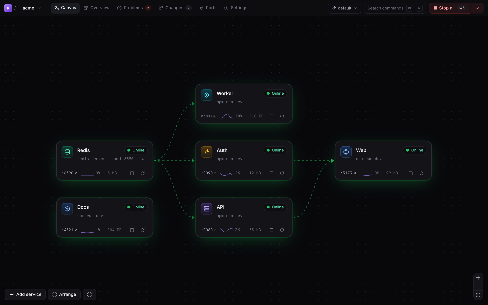
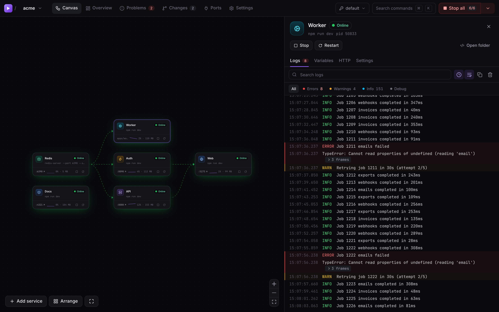
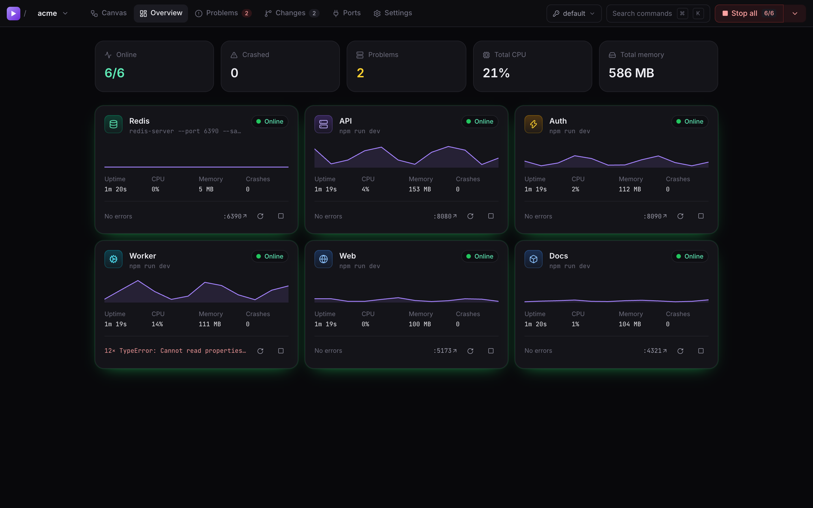
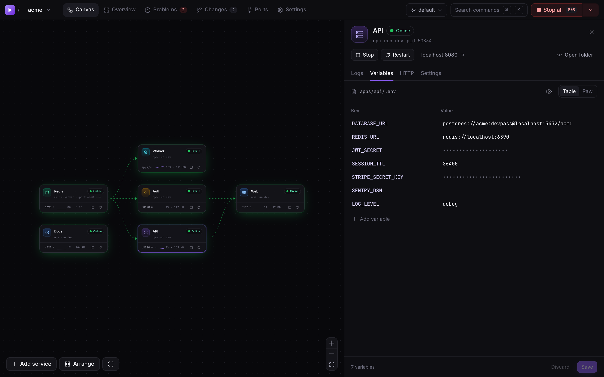
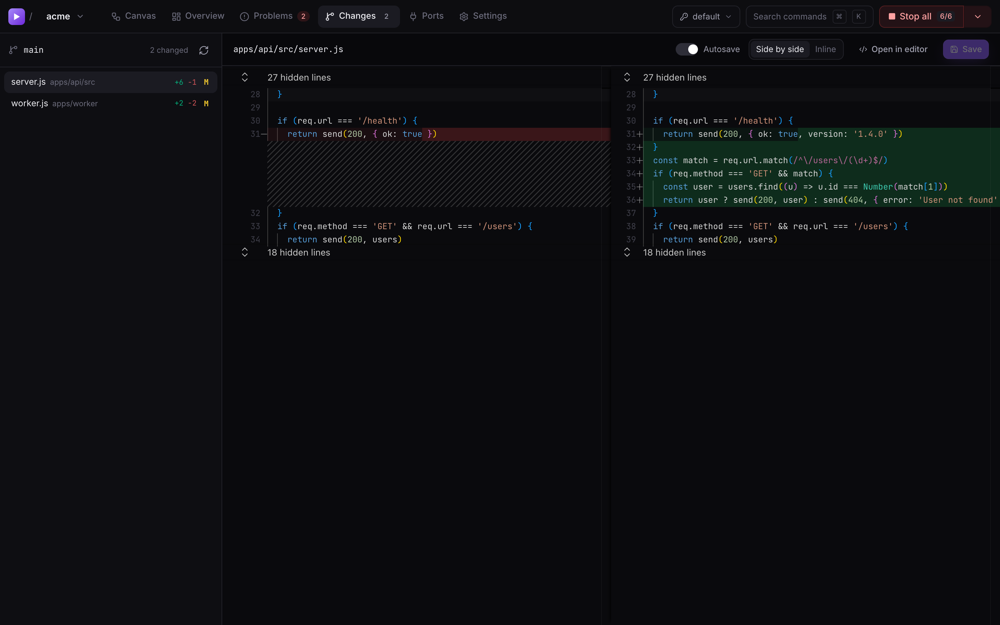
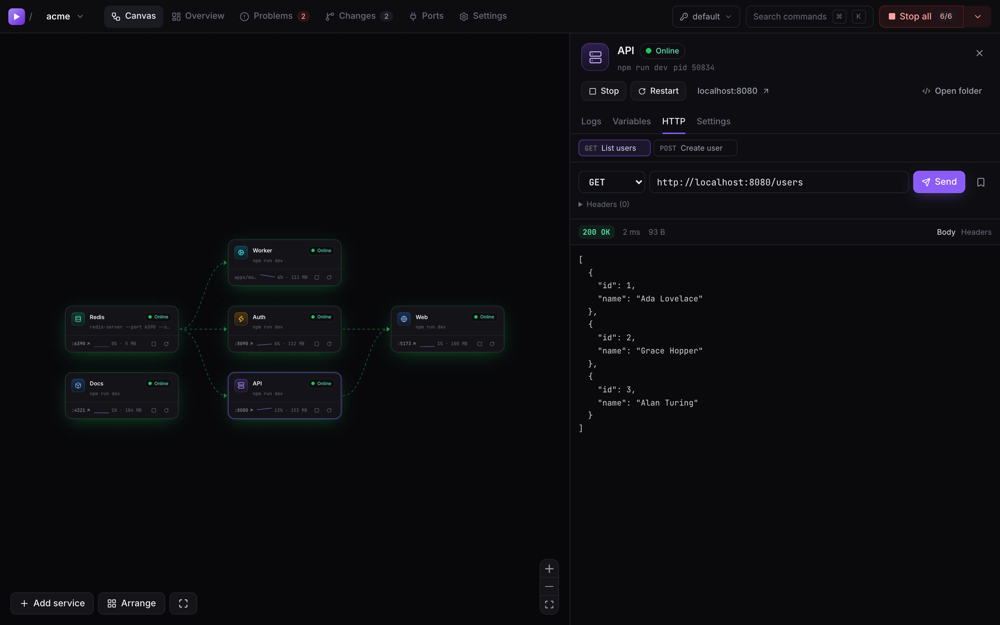
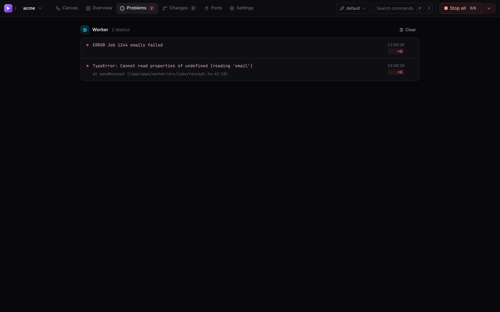
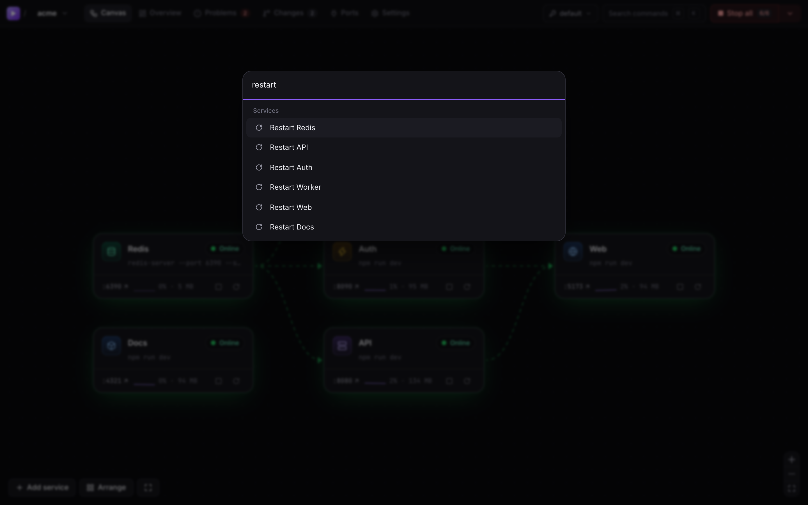
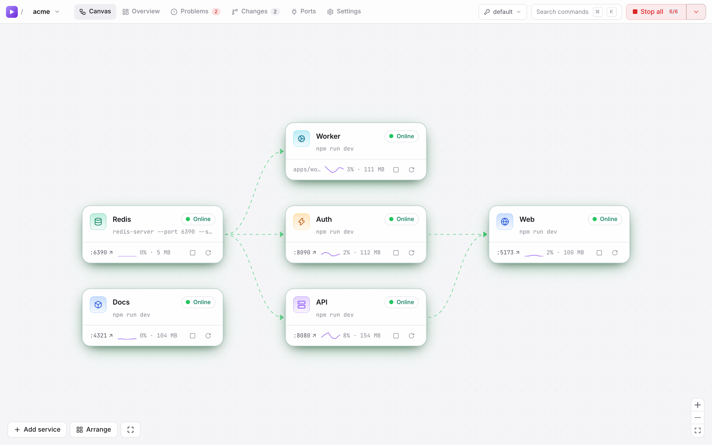

<div align="center">

# Runcraft

**A visual control center for your local dev servers.**

Start, stop and watch every service in your project from one canvas in your browser.<br>
No more juggling terminal tabs.

[](https://www.npmjs.com/package/runcraft)
[](https://www.npmjs.com/package/runcraft)
[](https://nodejs.org)
[](https://github.com/thekirankumarv/runcraft/actions/workflows/ci.yml)
[](LICENSE)



</div>

## Quick start

```sh
cd your-project
npx runcraft
```

Runcraft opens in your browser and scans the project for things it can run: package.json scripts (including monorepo workspaces), Procfile, docker compose, Makefile, Django, Rails, Go and Rust. Pick the ones you want, press **Start all**, and you are done.

Requires Node.js 20.11 or newer. Works on macOS and Linux. Windows support is new, so please [report anything that breaks](https://github.com/thekirankumarv/runcraft/issues).

## Why Runcraft

- **One place for everything.** Every service, its logs, variables and health, side by side.
- **Starts things in the right order.** Draw a line between two services and the dependency starts first, and must be healthy, before the other one starts.
- **Stops things properly.** Each service's whole process tree is killed, so ports are actually freed.
- **Shared with your team.** The setup is saved to `runcraft.json`. Commit it and everyone gets the same canvas.
- **Fully local.** No account, no cloud, no telemetry. One small dependency.

## Tour

### Logs that are easy to read

Live, searchable and filtered by level. Stack traces fold under their error, and `file:line` references open in your editor.



### Health at a glance

Uptime, CPU and memory charts, crash counts and the latest error for every service.



### Environment variables without the hunting

Edit `.env` files as a table or raw text. Secrets are masked, and comments and ordering are kept. Switch between profiles like `staging` from the top bar.



### Review and edit changes

Uncommitted git changes in a side-by-side diff, editable in place.



### Test your API next to it

Send requests to a service and save them with it, so your team gets them too.



### Every error in one list

Errors from all services, grouped and counted.



### Keyboard first

Press <kbd>⌘K</kbd> or <kbd>Ctrl+K</kbd> to start, stop, restart or jump anywhere.



### Light and dark

Follows your system theme, or pick one.



### And more

- **Port management.** See everything listening on your machine and free a stuck port in one click. If a service's port is taken, Runcraft shows who has it and offers **Kill & start**.
- **Auto-restart** on crash, with backoff, and **restart on file change** for processes that do not reload themselves.
- **Start profiles** such as "Frontend" or "Backend".
- **Templates** for Next.js, Vite, NestJS, Django, FastAPI, Rails, Postgres, Redis, MongoDB, Stripe webhooks, ngrok and more. Save your own services as templates too.
- **Multiple projects**, with import and export.
- **Crash notifications** in the app and on your desktop.
- **A CLI**: `runcraft status`, `start`, `stop`, `restart` and `logs -f` from any terminal.

## Configuration

Everything you set up in the UI is saved to `runcraft.json` in your project:

```json
{
  "name": "acme",
  "services": [
    { "id": "db", "name": "Postgres", "cwd": ".", "command": "docker compose up db", "port": 5432 },
    {
      "id": "api",
      "name": "API",
      "cwd": "apps/api",
      "command": "pnpm dev",
      "envFile": ".env",
      "port": 4000,
      "dependsOn": ["db"],
      "health": { "type": "http", "url": "http://localhost:4000/health" }
    },
    { "id": "web", "name": "Web", "cwd": "apps/web", "command": "pnpm dev", "dependsOn": ["api"] }
  ]
}
```

Settings that only apply to your machine, such as a different port, your editor or the active environment, go in `runcraft.local.json`, which stays out of git. See the [configuration reference](docs/configuration.md) for every option.

## Documentation

- [Getting started](docs/getting-started.md): install, first run, adding services
- [Features guide](docs/features.md): every screen explained
- [Configuration reference](docs/configuration.md): `runcraft.json`, `runcraft.local.json`, environment profiles
- [Command line](docs/cli.md): drive Runcraft from a terminal
- [Troubleshooting](docs/troubleshooting.md): common problems and fixes
- [Security](SECURITY.md): how Runcraft protects your machine, and how to report a vulnerability
- [Contributing](CONTRIBUTING.md): run Runcraft from source and send a pull request
- [Changelog](CHANGELOG.md): what changed in each release

## Security

Runcraft runs commands on your machine, so it is locked down by default. It only listens on `127.0.0.1`, every request needs a private token, and requests from other websites are rejected. See [SECURITY.md](SECURITY.md).

Like `package.json` scripts, `runcraft.json` contains shell commands. Review it before pressing Start in a repository you do not trust.

## License

[MIT](LICENSE) © Kiran Kumar V
