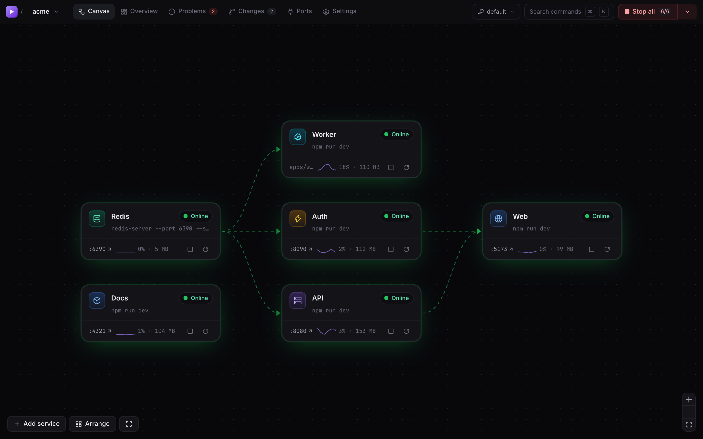
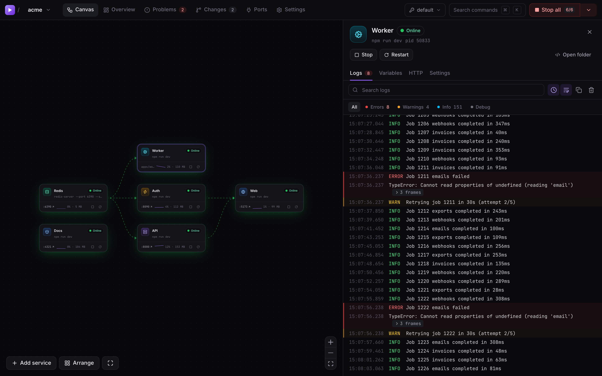
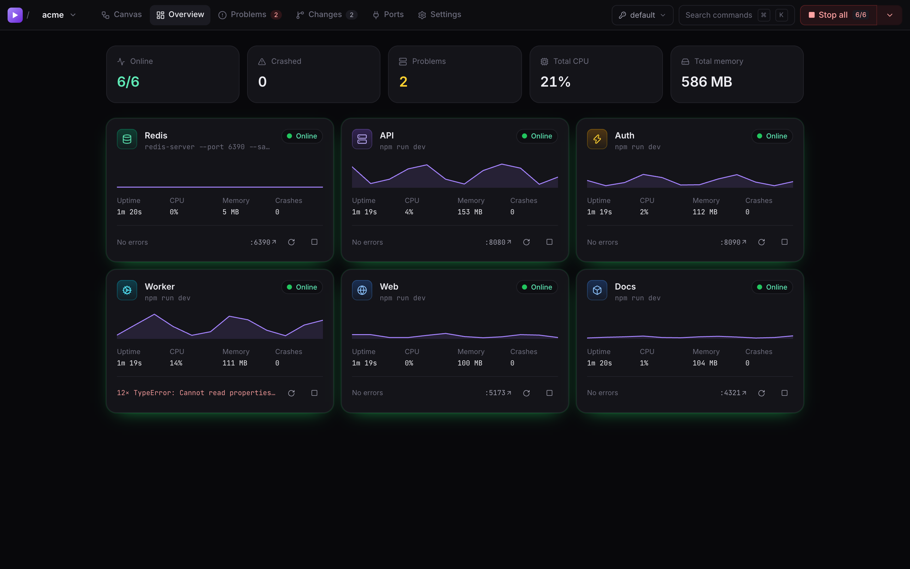
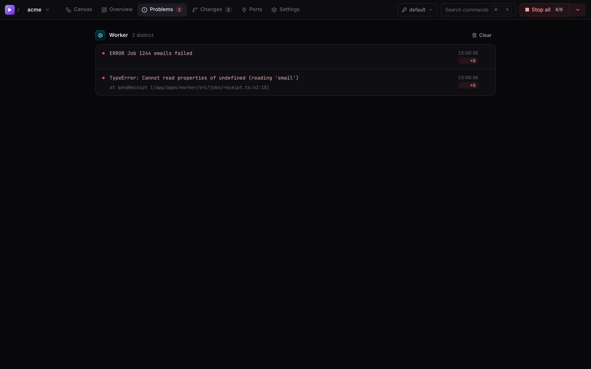
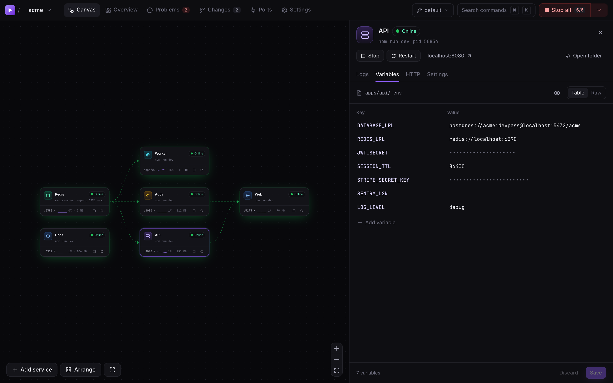
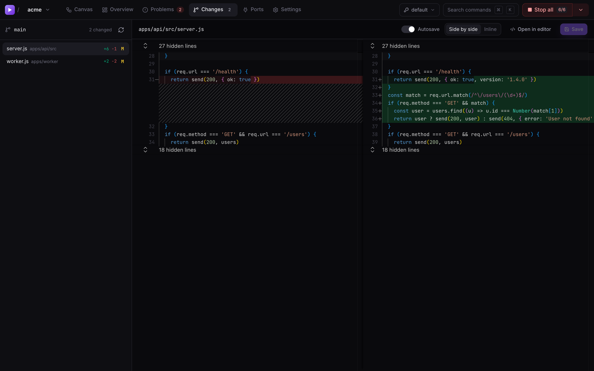
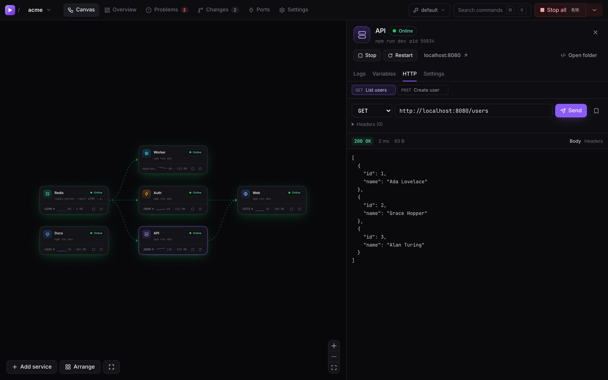
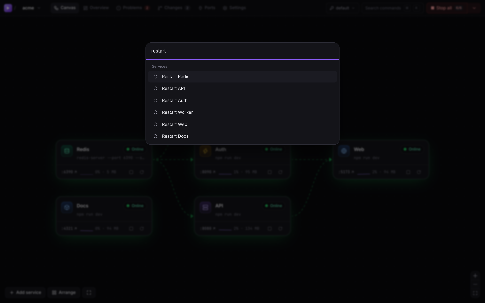

# Features guide

## Canvas

Every service is a card showing its status, command, port, CPU and memory.

| Status    | Meaning                                  |
| --------- | ---------------------------------------- |
| Online    | Running and passing its health check     |
| Starting  | Launched, waiting for the health check   |
| Unhealthy | Running, but the health check is failing |
| Crashed   | Exited with an error, or could not start |
| Stopped   | Stopped by you, or exited cleanly        |
| Idle      | Not started yet                          |

Badges on a card tell you when something needs attention:

- **Port busy**: another process holds the port. **Kill & start** stops that process and starts the service.
- **Changes pending**: you changed a setting or environment variable that only applies after a restart.

## Logs

Open a service and choose **Logs**.

- Filter by level: errors, warnings, info, debug.
- Search with highlighting.
- Stack traces fold under the error they belong to.
- `file:line` references are links that open in your editor. Choose the editor in **Settings → Editor**.
- Toggle timestamps and line wrapping, copy the visible lines, or clear the buffer.
- New output follows automatically. Scroll up to pause, and use the button at the bottom to jump back.

Runcraft keeps the latest 5,000 lines per service.

## Overview

A health dashboard for the whole project: how many services are online, crashes, problems, and total CPU and memory. Each card shows uptime, a CPU chart, memory, crash count and the latest error.

## Problems

Every error from every service in one list. Repeats of the same error are grouped with a count, even when they differ only in timestamps or IDs. Click an error to open that service's logs, filtered to errors.

## Variables

Edit a service's environment variables as a table or as raw text.

- Changes are written back to the service's `.env` file. Comments, blank lines and ordering are kept, and only the lines you changed are rewritten.
- A backup of the file is saved in `~/.runcraft/backups` before every write.
- Values whose names look secret (`TOKEN`, `KEY`, `PASSWORD`, `SECRET` and similar) are masked until you reveal them.
- Paste a whole `.env` file into Raw mode to import it.

If a service has no env file, variables are stored in `runcraft.json` under `env`.

### Environment profiles

Add profiles like `staging` in **Settings → Environment profiles**, then switch with the button in the top bar. With a profile active, each service reads its env file and then `<envFile>.<profile>` on top, for example `.env` and then `.env.staging`. Values that come from the base file are shown dimmed, and **Override** copies one into the profile file. Edits go to the profile file.

## Changes

Lists uncommitted git changes in the project. Pick a file to see a side-by-side or inline diff. The right side is editable: press <kbd>⌘S</kbd> / <kbd>Ctrl+S</kbd> to save, or turn on **Autosave**. **Open in editor** opens the file in your editor.

## HTTP client

Each service has an **HTTP** tab for sending requests. Choose a method, URL, headers and body, then press <kbd>Enter</kbd> or **Send**. JSON responses are formatted. Use the bookmark button to save a request; saved requests are stored with the service in `runcraft.json`, so your team gets them too.

Requests are sent from the Runcraft server, so there are no CORS problems.

## Ports

Lists every process listening on a TCP port on your machine, with the Runcraft service that owns it. Filter by port or process name, and kill a process to free its port. Killing asks for confirmation.

## Command palette

Press <kbd>⌘K</kbd> on macOS or <kbd>Ctrl+K</kbd> on Windows and Linux to:

- start, stop or restart any service, or start a profile
- open a service's logs
- jump to any view
- switch project, environment or theme
- add a service, arrange the canvas or open a folder

## Settings

- **Project**: rename, open `runcraft.json`, export or import the configuration.
- **Appearance**: system, dark or light theme. Saved in this browser.
- **Editor**: where file links open (VS Code, Cursor, Windsurf, VS Code Insiders, Zed).
- **Environment profiles**: add or remove profiles.
- **Start profiles**: named groups of services to start together.
- **Personal overrides**: shows what `runcraft.local.json` changes on your machine, and can add it to `.gitignore`.
- **Your templates**: templates you saved, available in every project.

## Templates

When adding a service, **Templates** has ready-made setups for Next.js, Vite, Node APIs, NestJS, Django, FastAPI, Rails, Go, Postgres, Redis and MongoDB (via Docker), Docker Compose, background workers, cron jobs, WebSocket servers, Stripe webhooks, ngrok, a local mail catcher and a blank custom command.

To save your own, open a service, go to **Settings** and press **Save template**. Your templates are stored in `~/.runcraft/templates.json`.

## Process management

- **Dependency order**: starting a service starts its dependencies first and waits until they are healthy (up to two minutes). Stopping stops dependents first.
- **Health checks**: by default Runcraft checks that the port accepts connections. You can use an HTTP URL instead (any response below 500 counts as healthy), or turn checks off, in which case a service counts as up once it has been running for a moment.
- **Clean shutdown**: stopping sends `SIGTERM` to the whole process tree and `SIGKILL` after 5 seconds. When you quit Runcraft it stops every running service first.
- **Auto-restart**: restart a service when it crashes, waiting 1, 2, 4… seconds between attempts, up to 30 seconds.
- **Restart on change**: restart when files in the listed paths change. Use this for processes that do not reload themselves.
- **Run before start**: a command to run before the main one, such as a migration or code generation.

## Notifications

When a service crashes or cannot start you get a toast in the app. If the Runcraft tab is in the background and you allowed notifications, you also get a desktop notification.

## Multiple projects

Open another project from the project menu in the top left, or by running `runcraft` in another folder. Each project keeps its own services, and they can run at the same time. The menu shows how many services are running in each project.
